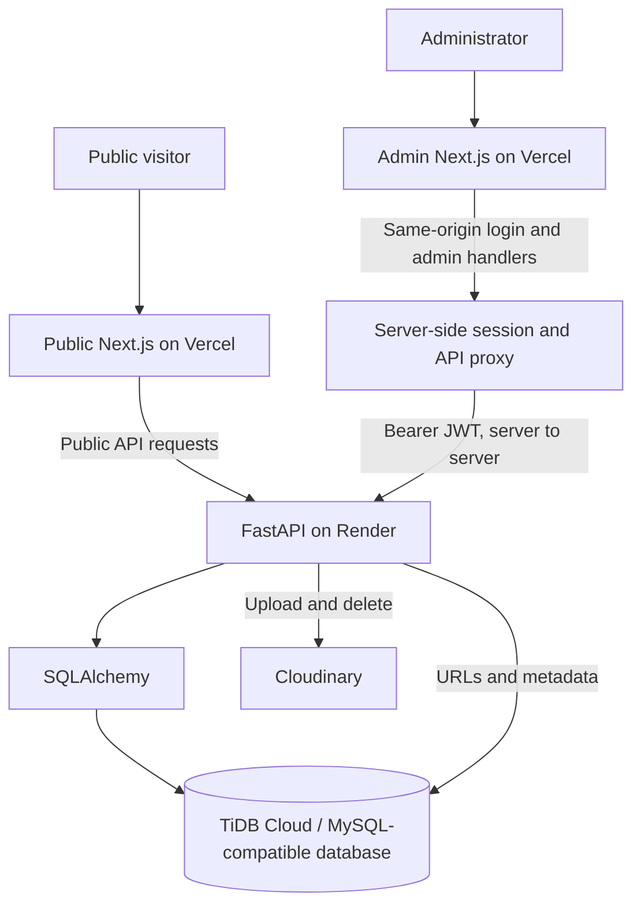

# Osamah Professional Portfolio

A full-stack portfolio and content-management system with a public portfolio, a separate private admin dashboard, and a FastAPI API. Structured content is stored in a MySQL-compatible TiDB Cloud database; uploaded media is stored in Cloudinary.

## Architecture



MySQL stores portfolio records and media references/metadata. Cloudinary stores file bytes. Neither Next.js app connects directly to MySQL or holds Cloudinary API credentials. The admin JWT is held in a signed HttpOnly cookie and forwarded only by server-side code. The cookie is signed, not encrypted.

## Applications and features

| Directory | Application | Routes / purpose |
|---|---|---|
| `frontend/` | Public Next.js portfolio | `/`, `/projects`, `/projects/[slug]`, `/certificates`; typed, API-driven portfolio content. |
| `Osamah-portfolio-admin-dashboard/` | Private Next.js CMS | `/admin/login`, `/admin`, `/admin/projects`, `/admin/experience`, `/admin/certificates`, `/admin/content`; content management for profile, skills, achievements, social links, and media. `/` redirects to `/admin`. |
| `portfolio-backend/` | FastAPI API | Public reads, protected admin mutations, authentication, database access, and Cloudinary media handling. |
| `osamah-portfolio/` | Static design reference | Design assets, not an application. |

Technology includes Next.js App Router, React, TypeScript, Tailwind CSS, Framer Motion (public app), Lucide React, FastAPI, Pydantic, SQLAlchemy, PyMySQL, Argon2, JWT, TiDB Cloud, and Cloudinary. See app READMEs for installed dependency ranges and exact commands. Run each application from its own directory; there is no root package project.

## Deployments

| Service | Location |
|---|---|
| Public portfolio | Vercel; public production URL is not recorded in this repository. Confirm it in Vercel before publishing a link. |
| Admin login | [osamah-professional-portfolio-mjul.vercel.app/admin/login](https://osamah-professional-portfolio-mjul.vercel.app/admin/login) |
| Backend API | [osamah-portfolio-api.onrender.com](https://osamah-portfolio-api.onrender.com) · [OpenAPI docs](https://osamah-portfolio-api.onrender.com/docs) |
| Database / media | TiDB Cloud / Cloudinary |

Set Vercel Root Directory to `frontend` for the public app and `Osamah-portfolio-admin-dashboard` for admin. For Render use Root Directory `portfolio-backend`, build `pip install -r requirements.txt`, and start `uvicorn app.main:app --host 0.0.0.0 --port $PORT`. These are hosting-dashboard settings; no Vercel/Render/Docker/CI deployment config is checked into the repo.

## Local development

Provision the database schema separately; the backend has no migration system and creates no tables at startup. Use each app's `.env.example`; never commit `.env` or `.env.local`.

### Backend (PowerShell, from `portfolio-backend/`)

```powershell
python -m venv .venv
.venv\Scripts\Activate.ps1
pip install -r requirements.txt
Copy-Item .env.example .env
# Configure local-only database, JWT, CORS, and Cloudinary settings.
uvicorn app.main:app --reload
```

API: `http://localhost:8000`; docs: `/docs`. With schema provisioned, run `python -m app.utils.create_profile` to create a missing neutral profile row (idempotent), and `python -m app.utils.create_admin --username admin` to create an admin; the latter prompts for a password. Check the active environment before running either command.

### Public frontend

From `frontend/`: `npm ci`, copy `.env.example` to `.env.local`, set `NEXT_PUBLIC_API_URL` and optionally `NEXT_PUBLIC_ADMIN_URL`, then `npm run dev` (port 3000).

### Admin dashboard

From `Osamah-portfolio-admin-dashboard/`: `npm ci`, copy `.env.example` to `.env.local`, configure `NEXT_PUBLIC_API_URL` and a unique `ADMIN_SESSION_SECRET`, then `npm run dev -- --port 3001`. Open `http://localhost:3001/admin/login`. Backend `FRONTEND_URL` must include the explicit browser origins used.

## Environment and deployment setup

Backend variables from `.env.example`: `APP_NAME`, `APP_VERSION`, `DEBUG`, `MYSQL_HOST`, `MYSQL_PORT`, `MYSQL_USER`, `MYSQL_PASSWORD`, `MYSQL_DATABASE`, `MYSQL_TLS_MODE`, `JWT_SECRET_KEY`, `JWT_ALGORITHM`, `ACCESS_TOKEN_EXPIRE_MINUTES`, `CLOUDINARY_CLOUD_NAME`, `CLOUDINARY_API_KEY`, `CLOUDINARY_API_SECRET`, `MEDIA_MAX_UPLOAD_SIZE_MB`, `FRONTEND_URL`. Public frontend: `NEXT_PUBLIC_API_URL`, `NEXT_PUBLIC_ADMIN_URL`. Admin: `NEXT_PUBLIC_API_URL`, `ADMIN_SESSION_SECRET`.

Use `MYSQL_TLS_MODE=verify_identity` for TiDB Cloud (certificate and hostname verification); `preferred` is available for local MySQL. For Vercel public, set `NEXT_PUBLIC_API_URL=https://osamah-portfolio-api.onrender.com` and `NEXT_PUBLIC_ADMIN_URL=https://osamah-professional-portfolio-mjul.vercel.app/admin/login`. For admin set the same backend URL and a private `ADMIN_SESSION_SECRET` (at least 32 bytes). Set Render's explicit `FRONTEND_URL` to both deployed app origins and keep JWT, DB, and Cloudinary credentials in Render settings only. Ensure Cloudinary permits PDF delivery if PDFs are used. Deploy each service from its own host project; this README does not deploy anything.

## Validation

```powershell
# Backend, from portfolio-backend/
python -B -c "from app.main import app; app.openapi()"
python -B -m unittest discover -v
# Public frontend, from frontend/ (no package typecheck script)
npx tsc --noEmit
npm run lint
npm run build
# Admin, from Osamah-portfolio-admin-dashboard/
npm run typecheck
npm run lint
npm run build
```

The backend suite currently has 26 passing tests, using fake DB sessions and mocked provider operations; it does not prove live TiDB or backend-mediated Cloudinary integration. Admin has no test script. Builds/static checks do not verify service connectivity.

## Security and troubleshooting

- `NEXT_PUBLIC_*` values are browser-visible; never put secrets there. Keep `JWT_SECRET_KEY`, `ADMIN_SESSION_SECRET`, DB credentials, and Cloudinary API credentials private.
- Admin cookie is HttpOnly, SameSite Strict, Secure in production, and signed but not encrypted. Keep JWT handling server-side.
- Store binaries in Cloudinary and references/metadata in MySQL, never file bytes in MySQL.
- If API calls return 503, inspect sanitized Render diagnostics and database settings. A prior repository verification recorded MySQL authentication error 1045; recheck current connectivity.
- For admin login, verify API URL, admin account, backend availability, and CORS origins; do not bypass auth/CORS.
- Admin file controls cap uploads at 4 MB for the Vercel function request path; backend defaults to 10 MB, configurable from 1 to 100 MB.
- Windows/OneDrive `.next` `EPERM` has occurred in this workspace. Check exact path/error; repository notes successful builds from a temporary copy outside OneDrive.

Further detail: [Public README](frontend/README.md) · [Admin README](Osamah-portfolio-admin-dashboard/README.md) · [Backend README](portfolio-backend/README.md).
