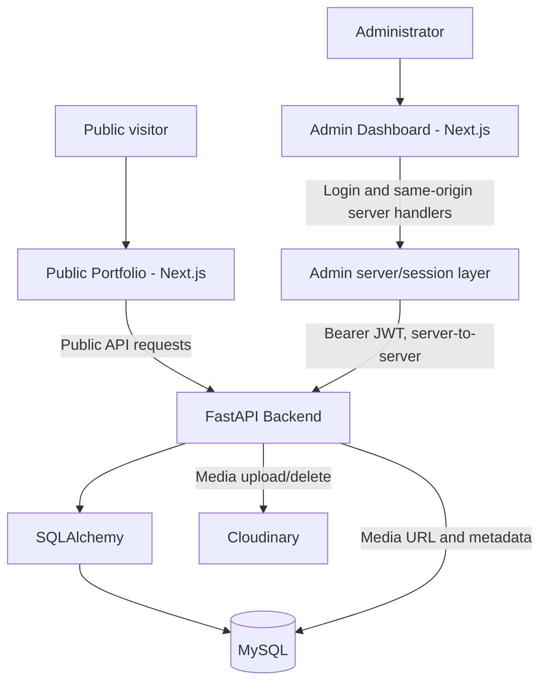

# Osamah Professional Portfolio

A production-oriented portfolio and content-management codebase composed of a public website, a separate Admin Dashboard, and a FastAPI Backend. Portfolio content is stored in MySQL and media files are stored in Cloudinary.

## Overview

The applications have separate responsibilities:

- **Public Portfolio** renders the portfolio and reads public data from the backend.
- **Admin Dashboard** authenticates administrators and provides management workflows through server-side Next.js handlers.
- **FastAPI Backend** validates requests, enforces admin authorization, persists structured records, and coordinates Cloudinary media operations.
- **MySQL** stores portfolio records, admin users, and media metadata. It does not store uploaded file bytes.
- **Cloudinary** stores public media files and returns delivery URLs.

The backend communicates with MySQL and Cloudinary separately. The database does not act as a proxy for Cloudinary.

## Architecture



## Repository structure

```text
frontend/                          Public Portfolio Next.js application
portfolio-backend/                 FastAPI Backend
Osamah-portfolio-admin-dashboard/  Private Admin Dashboard Next.js application
osamah-portfolio/                   Stitch/design reference assets
```

The design-reference directory is not an application. There is no root JavaScript package; install and run each app from its own directory.

## Technology

| Area | Technologies present in the project |
|---|---|
| Public Portfolio | Next.js App Router, React, TypeScript, Tailwind CSS, Framer Motion, Lucide React |
| Admin Dashboard | Next.js App Router, React, TypeScript, Tailwind CSS, Lucide React |
| FastAPI Backend | Python, FastAPI, Pydantic v2 / Pydantic Settings, SQLAlchemy, PyMySQL |
| Authentication | Argon2 password hashing, JWT bearer tokens, HMAC-signed HttpOnly admin session cookie |
| Persistence and media | MySQL, Cloudinary |

The app manifests and `portfolio-backend/requirements.txt` are the authoritative dependency lists. Docker/Compose and GitHub Actions configuration were not found in the repository.

## Features and routes

### Public Portfolio

- API-driven profile, experience, skills, achievements, social links, and featured content on the Home page.
- Projects archive and slug-based project detail pages with external GitHub/live links.
- Certificates archive.
- Resume link uses the profile's stored URL and opens it in a new tab. The browser's PDF display/download behavior depends on the Cloudinary response headers and delivery configuration.
- Responsive layouts, loading/error/empty states, and local/Cloudinary image handling.

Routes: `/`, `/projects`, `/projects/[slug]`, `/certificates`.

### Admin Dashboard

- Admin login, protected overview, logout, and responsive admin shell.
- Management workflows for projects, experience, certificates, profile, skill categories/skills, achievements, social links, and media.
- Multipart media uploads are forwarded through authenticated server-side handlers; browser code does not receive Cloudinary credentials or the backend JWT.

Routes: `/admin/login`, `/admin`, `/admin/projects`, `/admin/experience`, `/admin/certificates`, `/admin/content`. The Admin Dashboard `/` redirects to `/admin`.

### FastAPI Backend

Public GET APIs serve the public portfolio data. Protected admin routes provide create/update/delete operations, profile updates, media inventory, and media uploads. See [the backend guide](portfolio-backend/README.md) for the endpoint inventory.

## Database and media

The SQLAlchemy models define `users`, `projects`, `experiences`, `certificates`, `skill_categories`, `skills`, `achievements`, `social_links`, `profiles`, and `media`. The only declared ORM relationship is SkillCategory → Skill. Profile routes operate on the first profile row by ascending ID; the database does not enforce a singleton profile.

MySQL stores media `file_url`, Cloudinary `public_id`, MIME/file type, alt text, and timestamps. Cloudinary stores the binary files. The upload endpoint accepts JPG/JPEG, PNG, WEBP, and PDF; the backend validates filename extension, declared MIME type, content signature, and size (10 MB by default, configurable from 1–100 MB).

New PDF uploads use Cloudinary `resource_type="image"` so PDF delivery can use the image delivery path. Cloudinary PDF delivery must be enabled in the product environment. Existing raw PDF records remain deletable: the backend determines their Cloudinary resource type from the stored delivery URL. The Public Portfolio opens the profile resume URL directly; actual inline display depends on Cloudinary returning a PDF response that the browser can render inline.

## Local development

Provision MySQL and its schema separately before using database-backed operations. The backend has no migration tool and does not create tables at startup. Copy the relevant `.env.example` to the app's private environment file; never commit private environment files.

### FastAPI Backend

From `portfolio-backend/` in PowerShell:

```powershell
python -m venv .venv
.venv\Scripts\Activate.ps1
pip install -r requirements.txt
Copy-Item .env.example .env
# Configure MySQL, JWT, CORS and (when using media) Cloudinary locally.
uvicorn app.main:app --reload
```

After the schema is provisioned, initialize the singleton profile row once if it does not exist, and create an admin account:

```powershell
python -m app.utils.create_profile
python -m app.utils.create_admin --username admin
```

The profile command creates an empty initial row only if no profile row exists. The admin command prompts for the password interactively. API documentation is available at `http://localhost:8000/docs`.

### Public Portfolio

From `frontend/`:

```powershell
npm ci
Copy-Item .env.example .env.local
# Set NEXT_PUBLIC_API_URL to the FastAPI base URL.
npm run dev
```

The development server defaults to `http://localhost:3000`.

### Admin Dashboard

From `Osamah-portfolio-admin-dashboard/`:

```powershell
npm ci
Copy-Item .env.example .env.local
# Set NEXT_PUBLIC_API_URL and a unique ADMIN_SESSION_SECRET locally.
npm run dev -- --port 3001
```

Open `http://localhost:3001/admin/login`. Configure backend `FRONTEND_URL` with the explicit origins used by the browser, typically both local frontend origins when both apps are used. Wildcard CORS origins are rejected.

## Environment variables

Use each application's `.env.example` for variable names. Values below describe purpose only; do not put secrets in source control or documentation.

| Application | Variables and purpose |
|---|---|
| FastAPI Backend | `APP_NAME`, `APP_VERSION`, `DEBUG` (app settings); `MYSQL_HOST`, `MYSQL_PORT`, `MYSQL_USER`, `MYSQL_PASSWORD`, `MYSQL_DATABASE` (database connection); `JWT_SECRET_KEY`, `JWT_ALGORITHM`, `ACCESS_TOKEN_EXPIRE_MINUTES` (backend token signing/expiry); `CLOUDINARY_CLOUD_NAME`, `CLOUDINARY_API_KEY`, `CLOUDINARY_API_SECRET` (server-side media provider); `MEDIA_MAX_UPLOAD_SIZE_MB` (upload cap); `FRONTEND_URL` (comma-separated explicit CORS origins). |
| Public Portfolio | `NEXT_PUBLIC_API_URL` (public FastAPI base URL). |
| Admin Dashboard | `NEXT_PUBLIC_API_URL` (FastAPI base URL); `ADMIN_SESSION_SECRET` (server-only HMAC key for the session cookie, at least 32 UTF-8 bytes). |

`NEXT_PUBLIC_*` variables are browser-visible. Never place database credentials, JWT signing keys, Cloudinary API secrets, or `ADMIN_SESSION_SECRET` in public frontend variables or client code.

## Validation

Run checks from each application's directory:

```powershell
# FastAPI Backend
python -B -c "from app.main import app"
python -B -m unittest discover -v

# Public Portfolio (no typecheck package script)
npx tsc --noEmit
npm run lint
npm run build

# Admin Dashboard
npm run typecheck
npm run lint
npm run build
```

At this documentation update, the backend suite has 20 passing tests and FastAPI/OpenAPI loads. The backend tests use fake database sessions and mocked Cloudinary calls; they do not prove live database or provider integration. TypeScript and ESLint commands are available for both Next.js applications. No live-service status is implied by these checks.

## Production and security

The repository includes Next.js production build/start scripts and the FastAPI app entry point, but no deployment, Docker, Compose, CI/CD, or production infrastructure configuration. Deployment must separately provide the database schema, secure environment values, explicit CORS origins, Cloudinary PDF delivery configuration, and runtime hosting.

- Use Argon2 hashes for admin passwords; never store plaintext passwords.
- The admin JWT cookie is HttpOnly, SameSite Strict, and Secure in production. It is HMAC-signed, not encrypted; keep token handling in server-only code.
- FastAPI independently verifies JWT signature/expiry and checks that the admin user exists.
- Keep all backend and session secrets private and out of logs, URLs, browser storage, and frontend bundles.
- Keep uploaded bytes in Cloudinary and metadata/URLs in MySQL.
- Inspect the backend schema and both frontend API integrations before changing an API contract.

For application-specific commands and contracts, see the [Backend README](portfolio-backend/README.md), [Public Portfolio README](frontend/README.md), and [Admin Dashboard README](Osamah-portfolio-admin-dashboard/README.md).
