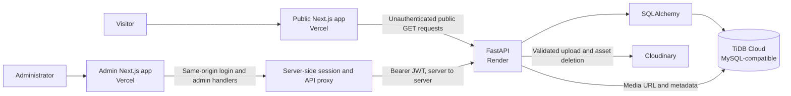

# Osamah Professional Portfolio

A portfolio platform with a public Next.js site, a separate administrator dashboard, and a FastAPI backend. Structured portfolio data is stored in a MySQL-compatible database; uploaded media files are stored in Cloudinary.

## Applications

| Directory | Role | Documentation |
|---|---|---|
| `frontend/` | Public portfolio: home, project archive/details, and certificates | [Frontend README](frontend/README.md) |
| `Osamah-portfolio-admin-dashboard/` | Private CMS, login, and account settings | [Admin README](Osamah-portfolio-admin-dashboard/README.md) |
| `portfolio-backend/` | FastAPI routes, validation, authentication, persistence, and media integration | [Backend README](portfolio-backend/README.md) |
| `osamah-portfolio/` | Static design reference; not an application | See its `DESIGN.md` |

## Architecture



This diagram describes the source architecture. The deployed service configuration and live connections have not been fully verified from this repository. The admin session cookie is signed, not encrypted. Its HttpOnly flag prevents browser JavaScript access; JWT extraction and forwarding must remain server-side. Database records store media references and metadata, not file bytes.

## Implemented in source

- Public pages retrieve profile, projects, experience, skills, certificates, achievements, and social links from typed backend API functions. Sections handle empty or failed requests independently.
- The admin dashboard has protected CRUD/content tools for projects, experience, certificates, skills, achievements, profile, social links, and media.
- Admin account settings change username and password after current-password verification. Password changes expire the dashboard cookie and require login again; backend JWTs are stateless and are not revoked server-side.
- Authenticated media uploads pass through the admin server handlers and FastAPI to Cloudinary. Supported backend upload formats are JPEG, PNG, WEBP, and PDF; configurable backend size cap defaults to 10 MB. The admin upload control also enforces a 4 MB cap for the Vercel request path.
- Project cards use fixed landscape frames with contained images; experience logos use larger responsive frames and fallback initials.

These are code features, not claims of production availability. See service READMEs for route and validation details.

## Local development

Each application is independent; run it from its own directory. Use each app's `.env.example` as a template. Never commit `.env` or `.env.local`.

### Backend (PowerShell, `portfolio-backend/`)

```powershell
python -m venv .venv
.venv\Scripts\Activate.ps1
pip install -r requirements.txt
Copy-Item .env.example .env
# Configure local database, JWT, CORS, and Cloudinary settings as needed.
uvicorn app.main:app --reload
```

The API listens on `http://localhost:8000`, with Swagger at `/docs` and OpenAPI JSON at `/openapi.json`. The backend does not create tables on startup. Follow [backend schema setup](portfolio-backend/README.md#database-and-schema) before making database-backed requests.

### Public frontend

In `frontend/`, run `npm ci`, copy `.env.example` to `.env.local`, set `NEXT_PUBLIC_API_URL`, then run `npm run dev`. The default port is 3000.

### Admin dashboard

In `Osamah-portfolio-admin-dashboard/`, run `npm ci`, copy `.env.example` to `.env.local`, configure `NEXT_PUBLIC_API_URL` and a unique server-only `ADMIN_SESSION_SECRET`, then run `npm run dev -- --port 3001`. Open `http://localhost:3001/admin/login`.

## Deployment status

The repository has no checked-in Vercel, Render, Docker, or CI deployment configuration. Root directories, environment variables, and commands below describe settings to enter in the hosting dashboards; they do not prove what is currently configured there.

| Service | Dashboard setting / recorded URL | Verification status |
|---|---|---|
| Public Vercel app | Root Directory `frontend` | Project identity, production URL, branch, and deployment status require confirmation in Vercel. |
| Admin Vercel app | Root Directory `Osamah-portfolio-admin-dashboard`; recorded login URL: [admin login](https://osamah-professional-portfolio-mjul.vercel.app/admin/login) | Project settings and live login require confirmation. |
| Render API | Root Directory `portfolio-backend`; build `pip install -r requirements.txt`; start `uvicorn app.main:app --host 0.0.0.0 --port $PORT`; recorded API: [osamah-portfolio-api.onrender.com](https://osamah-portfolio-api.onrender.com) | Service name/settings and current health require confirmation. `/docs` is the API docs page; no custom health-check endpoint exists. |
| Database and media | TiDB Cloud and Cloudinary | Live backend DB/media flow is not verified; see backend README. |

For production, set `NEXT_PUBLIC_API_URL` on each Vercel app to the API base URL; set the public app's optional `NEXT_PUBLIC_ADMIN_URL` to the admin login URL. Configure `ADMIN_SESSION_SECRET` only in the admin server environment. Configure database, JWT, Cloudinary, and explicit CORS-origin values in Render's private environment settings. Never put secrets in `NEXT_PUBLIC_*` variables.

## Environment overview

Exact variables and placeholders are listed in each application's README and `.env.example`:

- Public frontend: `NEXT_PUBLIC_API_URL`, optional `NEXT_PUBLIC_ADMIN_URL` (public values).
- Admin: `NEXT_PUBLIC_API_URL` (public) and `ADMIN_SESSION_SECRET` (private HMAC secret).
- Backend: `APP_NAME`, `APP_VERSION`, `DEBUG`, `MYSQL_HOST`, `MYSQL_PORT`, `MYSQL_USER`, `MYSQL_PASSWORD`, `MYSQL_DATABASE`, `MYSQL_TLS_MODE`, `JWT_SECRET_KEY`, `JWT_ALGORITHM`, `ACCESS_TOKEN_EXPIRE_MINUTES`, `CLOUDINARY_CLOUD_NAME`, `CLOUDINARY_API_KEY`, `CLOUDINARY_API_SECRET`, `MEDIA_MAX_UPLOAD_SIZE_MB`, and `FRONTEND_URL`.

Use placeholders only in documentation. Never expose secrets from local files, deployment settings, or logs.

## Validation commands

```powershell
# Backend, from portfolio-backend/
python -B -c "from app.main import app; app.openapi()"
python -B -m unittest discover -v

# Public app, from frontend/
npx tsc --noEmit
npm run lint
npm run build

# Admin app, from Osamah-portfolio-admin-dashboard/
npm run typecheck
npm run lint
npm run build
```

The backend suite uses fake database sessions and mocked provider paths; passing tests do not establish live DB or backend-mediated Cloudinary integration. Both Next apps have no live-service tests. OneDrive builds have encountered `.next` EPERM filesystem errors; see app READMEs for current check results.

## Known limitations and security

- The current backend test suite has 29 tests. Previous live DB verification reached MySQL but authentication failed with error 1045; recheck credentials/permissions before relying on production persistence.
- Direct Cloudinary provider upload/delete was previously verified, but the full backend upload plus database record flow and production uploads remain unverified.
- The backend includes `portfolio-backend/database/schema.sql` for one-time table provisioning, but no migration system. Startup does not create or migrate schema automatically.
- Admin JWTs use Argon2 password verification and server-side forwarding. Logout expires the dashboard cookie; no backend token revocation or refresh endpoint exists.
- Keep database, JWT, session, and Cloudinary credentials private. Avoid JWTs in browser state, HTML, URLs, logs, or client API responses.
- Do not commit environment files, generated build output, or credentials.

## Git review and release

Review changes before staging. After approval, stage only intended files, inspect the staged diff, and commit. Push only to a confirmed deployment branch after confirming the target Vercel/Render projects and monitoring their deployment logs. There is no in-repository CI/release workflow.

```powershell
git status --short
git diff --check
git diff
git add <approved-paths>
git diff --cached --check
git diff --cached
# After review:
git commit -m "docs: update portfolio documentation"
```

Never stage `.env`, `.env.local`, secrets, or generated build output.
